  <picture>
    <source media="(prefers-color-scheme: dark)" srcset="./assets/hero-dark.svg">
    <source media="(prefers-color-scheme: light)" srcset="./assets/hero-light.svg">
    
  </picture>

  

 

  <i>some things i've worked with along the way</i>

  
    AWS · GCP · Kubernetes · Docker · Linux · Terraform · GitHub Actions · Nginx · Python · FastAPI 
    MySQL · MongoDB · Redis · Prometheus · Grafana · Git · GitHub · OpenAI · RAG
  

 

ge-onu

