## 이건우 (Geonwoo Lee)

클라우드 · 네트워크 · 인프라 · AI/ML 엔지니어 직무에 지원하는 신입입니다. 
AI·ML 워크플로우와 이를 받치는 인프라·운영으로 성장하려 합니다.

[Portfolio](https://geonu.site) · [이력 요약 PDF](https://geonu.site/resume.pdf) · [LinkedIn](https://www.linkedin.com/in/geonwooleekr) · [Email](mailto:goonbam009@gmail.com)

### 대표 사례

- **Mealplanning · AI/ML 담당** ([상세](https://geonu.site/projects/mealplanning/) · [fork](https://github.com/ge-onu/mealplanning) · [데모](https://app.mealbong.cloud))
  - 더존비즈온 Cloud DX Academy 6기 최종 팀 프로젝트(5인, 최우수상)에서 핵심 AI 기능의 PoC·구현·트러블슈팅을 대부분 맡았습니다.
  - 응답 검증 오탐 원인을 찾아 근거 범위 수정을 이끌었고, 같은 275건에서 통과가 166건에서 247건으로 늘었습니다.
  - LLM 후보 15종을 누적 1,750건 평가 기록으로 비교했고, AI 기능 12종의 서버리스 전환을 판정해 Lambda 등 AWS 리소스를 Terraform으로 작성했습니다.
  - 추천 이벤트의 session_id 누락을 Frontend → API → Event Storage → Training Dataset 순서로 추적해 전달 경로를 고쳤습니다.
- **Kubernetes Multi-node Lab** ([상세](https://geonu.site/projects/kubernetes-lab/))
  - kubeadm 멀티노드 개인 실습에서 ImagePull·Service·RBAC·PVC 문제를 Event와 리소스 상태로 좁혔습니다.
- **디딤돌 · 개인 웹앱** ([상세](https://geonu.site/projects/didim/))
  - PC 한 대에서 FastAPI를 127.0.0.1에만 띄우고, 포트를 열지 않은 채 Cloudflare Tunnel로 공개했습니다.
- **RAG 챗봇 거누** ([상세](https://geonu.site/projects/rag-retrieval-poc/))
  - BM25 검색과 답변 허용 판단을 나눈 PoC를 Cloudflare Workers에 배포해, 포트폴리오 공개 기록으로만 답하게 했습니다.

### 비공개로 운영 중인 저장소

운영 중인 서비스와 개인 자료가 들어 있어 코드는 비공개로 두고, 무엇을 했는지만 적습니다. 
구현에는 AI 코딩 도구(Claude Code · Codex)와 AI 에이전트(Aside)를 활용했고, 설계 · 검증 · 운영 판단은 직접 했습니다.

| 저장소 | 무엇인가 | 한 일 |
|---|---|---|
| `didimdol` | 취업 준비 웹앱 [didimdol.site](https://didimdol.site) | FastAPI · SQLite를 WSL에서 systemd 사용자 서비스로 띄우고 Cloudflare Tunnel로 공개. 공고 우선순위, CKA 모의고사 해설, 메일 요약, 생각 정리(Codex · Jev · Claude 역할 분담) 기능. 자동 시험과 매일 DB 백업 |
| `aside-ops` | 개인 운영 감시 · 아침 요약 | LLM 없이 규칙만으로 서비스 · 터널 · 백업 · cron 상태를 30분마다 점검하고 Slack으로 알림. 아침 요약에 마감 임박 공고 · 결정할 일 · 안 올린 커밋 표시 |
| `mail-sift` | 메일 분류 · 요약 도구 | Gmail · 네이버 메일을 AI로 분류 · 요약해 Slack으로 알림. 로그인 만료 · 격리 메일 재처리 같은 장애를 겪고 복구 절차를 남김 |
| `jev-lab` | 판단 모델 Jev 실험장 | 메일 분류 · 공고 분류 · 알림 등급 등 5개 실험(1,613건)으로 쓸 곳과 버릴 곳을 판정. 공고 분류만 채택(정확도 88.2%, 확신 0.9 이상에서 96.4%) |
| `k8s-incident-response-lab` | Kubernetes 장애 재현 실습 | kind 클러스터에 장애 5종(CrashLoopBackOff, Ingress 5xx, NetworkPolicy · DNS, Pending, readiness)을 재현하는 시나리오와 진단 CLI. 직접 진단 연습은 진행 중 |
| `infra-aiops-career-hub` | 커리어 관리 저장소 | 지원 기록, 결정 기록, 채용 공고 수집, CKA 실습 문제 · 채점 스크립트를 한 곳에서 관리 |

### 기술

**직접 해 본 것** 
Python · PostgreSQL/SQL · LLM 평가 · AWS Lambda · SQS · SNS · S3 · Terraform · Cloudflare Tunnel · Workers · FastAPI · Git · GitHub

**개인 실습** 
Linux(Ubuntu) · Kubernetes(kubeadm) · Calico · Ingress · NetworkPolicy · RBAC · HPA/KEDA · Prometheus · Grafana

**팀 공동 설계** (Mealplanning, 도구 선택은 팀이 함께 · 설치·운영은 인프라 담당 팀원) 
Amazon EKS · Argo CD · CI/CD

### 자격

네트워크관리사 2급 (2026.06) · 리눅스마스터 2급 (2026.07) · CKA 준비 중

 

  <picture>
    <source media="(prefers-color-scheme: dark)" srcset="./assets/hero-dark.svg">
    <source media="(prefers-color-scheme: light)" srcset="./assets/hero-light.svg">
    
  </picture>

  

 

Korean new-grad aiming for cloud & infrastructure roles, growing toward AIOps.

